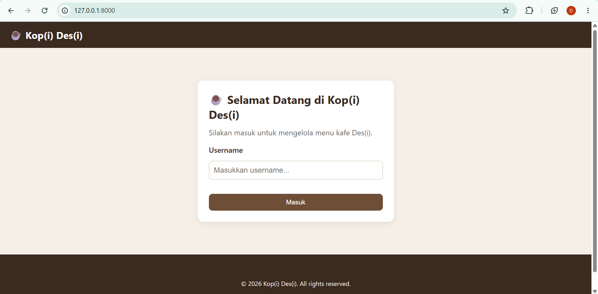
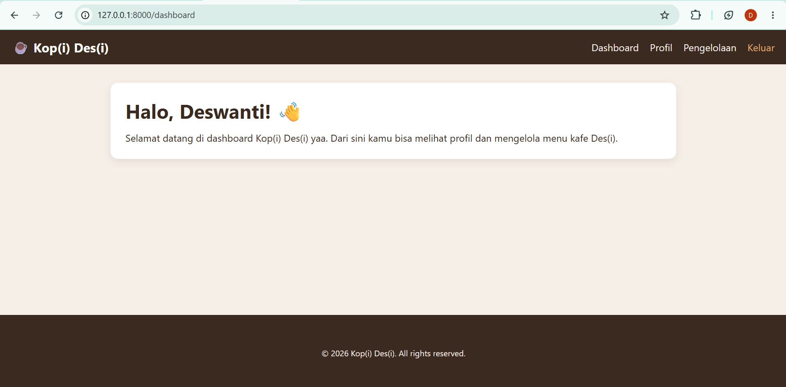
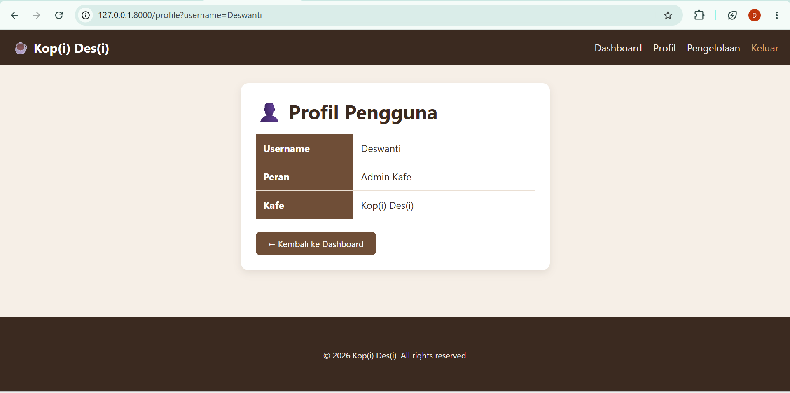
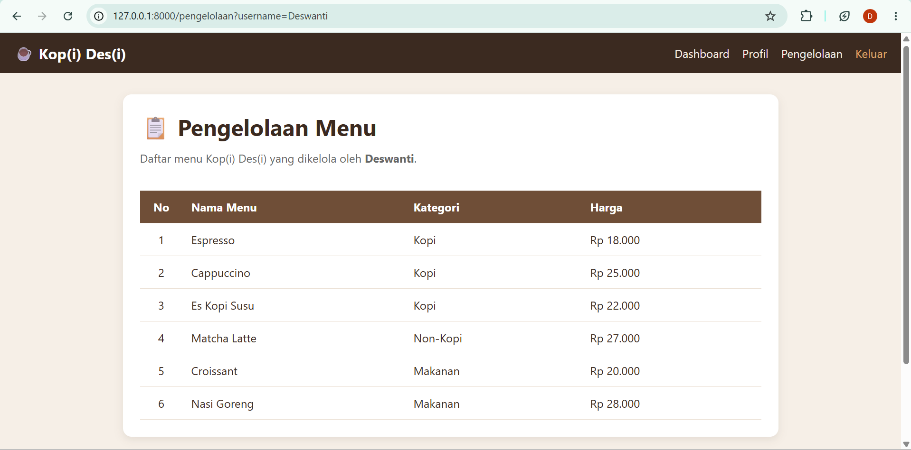

# UTS PWEB - Kop(i) Des(i)

Aplikasi web pengelolaan menu kafe "Kop(i) Des(i)" yang dibuat dengan Laravel (arsitektur MVC) dan Blade Templating.

## Fitur Utama
- Simulasi login dengan penerusan data username ke Dashboard dan Profil
- Halaman Dashboard dan Profil Pengguna
- Halaman Pengelolaan Menu (data dari Controller, ditampilkan dengan Blade loop)
- Layout modular memakai Blade Components & Directives (`@extends`, `@yield`, `@include`, `x-component`)

## Screenshot

### Halaman Login

### Halaman Dashboard

### Halaman Profil

### Halaman Pengelolaan Menu

## Cara Menjalankan Aplikasi
1. `composer install`
2. `cp .env.example .env`
3. `php artisan key:generate`
4. `php artisan serve`

---
**Disusun oleh:** Deswanti Tampubolon (NIM 252410102033)
